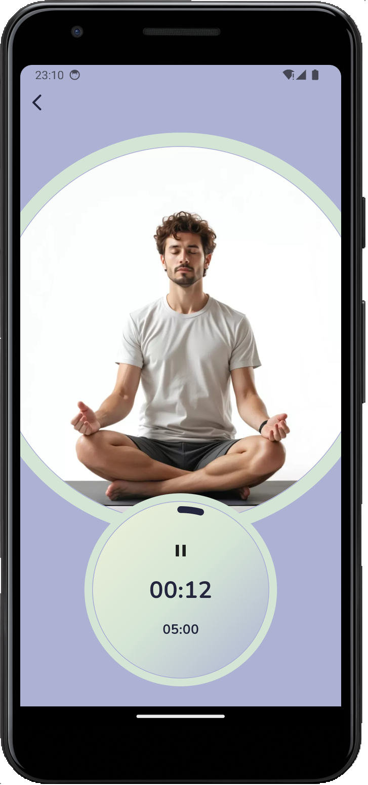
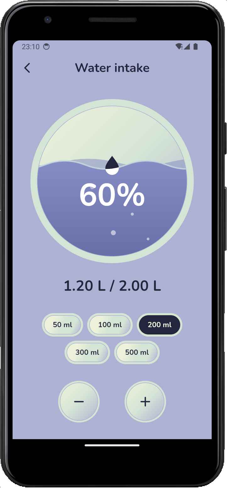
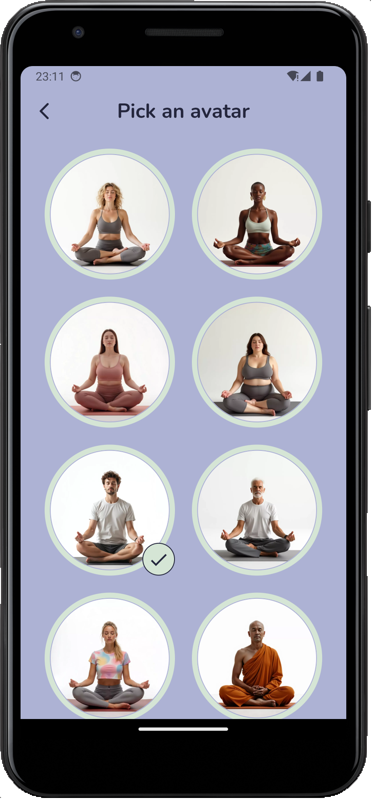

# Meditate App
[](https://opensource.org/licenses/MIT)

A simple meditation app built with Flutter, created to experiment with UI design and custom widgets.

<a href="https://github.com/thpir/Meditate-app/releases" target="_blank"></a>

## Screens

### Home
Set your meditation duration and background sound, then start a session. The drop icon in the top-right corner opens the water tracker.


### Session
A countdown timer with audio playback and a vibration notification when the session ends.



### Water Intake
Track how much water you drink today: pick an amount, tap + or − and watch the water rise toward your daily goal. The count resets automatically every day.



### Settings
Customize your display name and set your daily water goal.


### Pick Avatar
Choose an avatar that suits you.



## Architecture

The app follows the **MVVM** pattern with [Provider](https://pub.dev/packages/provider) for state management, split into three layers: **UI**, **domain** and **data**. Every screen talks to a view model, view models get their data from repositories, and repositories use services to reach the plugins. The one exception is audio playback: `MeditationSessionViewModel` drives `AudioService` directly, because the sound only lives as long as the session screen.

```
Widget  ──▶  ViewModel  ──▶  Repository  ──▶  Service  ──▶  plugin (shared_preferences, just_audio, …)
   ▲             │               │
   └── rebuilds ─┴── notifies ───┘   (ChangeNotifier)
```

### Project structure

```
lib/
├── main.dart                  # Providers, theme and named routes
├── data/
│   ├── services/              # Thin wrappers around plugins (SharedPrefsService, AudioService, LoggingService)
│   └── repositories/          # App-wide state + persistence (UserPreferences, WaterIntakeRepository)
├── domain/
│   └── models/                # Enums describing the app's options (Avatar, MeditationDuration, WaterGoal, …)
└── ui/
    ├── core/
    │   ├── theme/             # AppColors and AppTheme
    │   └── ui/                # Reusable design-system widgets
    └── <feature>/             # One folder per screen: home, water_intake, user_settings, …
        ├── view_model/        # <feature>_view_model.dart
        └── widgets/           # <feature>_screen.dart (+ the screen's private sub-widgets)
test/                          # Mirrors lib/
widgetbook/                    # Separate Flutter project: Widgetbook catalogue of the design system
```

### Layers

**Services** (`lib/data/services`) wrap a plugin and nothing more: no state, no business rules. Every call is wrapped in a `try`/`catch` that logs through `LoggingService`. `SharedPrefsService` then rethrows, so the repository can fall back to defaults, while `AudioService` carries on silently, so a sound that fails to play never blocks a session. Storage keys live in `SharedPrefsService` as `static const` strings in `UPPER_SNAKE_CASE`.

**Repositories** (`lib/data/repositories`) own the app's state and decide what gets stored. They extend `ChangeNotifier`, load their values from a service in the constructor, and expose a "loaded" flag (`prefsLoaded`, `loaded`) so the UI can show `WaitingScreen` until the data is there. Setters and methods update the in-memory value, persist it, and call `notifyListeners()`. Repositories are created once, at the root of the app in `main.dart`:

```dart
MultiProvider(
  providers: [
    ChangeNotifierProvider(create: (_) => UserPreferences()),
    ChangeNotifierProvider(create: (_) => WaterIntakeRepository()),
  ],
  child: MaterialApp(...),
)
```

**Domain models** (`lib/domain/models`) are enums with a `const` constructor and a stable `id` (plus whatever the UI needs, such as `name`, `imagePath` or `ml`). Store the `id` (or a value like `ml`), never the index. `SharedPrefsService.getInt` returns `0` for a missing key, so either make `id: 0` the default option or add a lookup with a fallback, like `WaterGoal.fromMl()`.

**View models** (`lib/ui/<feature>/view_model`) extend `ChangeNotifier` and are created **per screen**. They receive the repositories they need through their constructor and expose:
- getters with display-ready values (e.g. `amountLabel`, `progress`)
- setters or methods for user actions, named after the event (e.g. `addButtonPressed()`, `nameTextFieldOnChanged()`)
- UI-only objects such as a `TextEditingController`, which they dispose in `dispose()`

When repository data can change while the screen is open, the view model listens to the repository and re-notifies, so the screen updates (see `WaterIntakeViewModel`).

**Screens** (`lib/ui/<feature>/widgets`) are `StatelessWidget`s that create their view model and split the layout into small widgets in the same file:

```dart
class WaterIntakeScreen extends StatelessWidget {
  static const String routeName = '/water-intake';
  const WaterIntakeScreen({super.key});

  @override
  Widget build(BuildContext context) {
    final userPrefs = Provider.of<UserPreferences>(context, listen: false);
    final waterIntake = Provider.of<WaterIntakeRepository>(context, listen: false);
    return ChangeNotifierProvider(
      create: (_) => WaterIntakeViewModel(userPrefs, waterIntake),
      child: Scaffold(...),
    );
  }
}
```

Inside the widgets, use `context.watch<MyViewModel>()` to read values (the widget rebuilds when they change) and `context.read<MyViewModel>()` in callbacks. Screens adapt to the device with `OrientationBuilder` (a `Column` in portrait, a `Row` in landscape) and size circular elements with `LayoutBuilder`.

### Navigation

Navigation uses **named routes**. Each screen has a `static const String routeName`, every route is registered in `routes` in `main.dart`, and screens are opened with `Navigator.pushNamed(context, SomeScreen.routeName)`. Data that a screen needs at start is passed as a `Map` in `arguments` and read with `ModalRoute.of(context)!.settings.arguments` (see `MeditationSessionScreen`).

### Design system

- **Colors** come only from `AppColors` (`lib/ui/core/theme/app_colors.dart`); the font is **Nunito**, set in `AppTheme`.
- **Reusable widgets** live in `lib/ui/core/ui`: `RoundedButton`, `CustomDropdownMenu`, `CustomTextField`, `AvatarView`, `SelectedBadge`, `WaterIntakeView`, `WaterVolumeChip` and `WaitingScreen`. Reuse them before creating something new.
- **The signature look** is a light green (`tertiary`) outer ring or pill around an inner shape with a 1 px `primary` border and a `quaternary` → `tertiary` → `primary` gradient. Navy (`onPrimary`) is used for text and icons on the lavender (`primary`) background.
- **Widgetbook** shows every reusable widget with live knobs. It is a separate Flutter project in `widgetbook/` that depends on the app through `path: ../`, so Widgetbook and its plugins never become part of the app. **Don't add it as a dev dependency of the app**: Android release builds fail when a dev dependency brings in a plugin. Widgetbook itself still uses the framework's `package:flutter/material.dart`, so don't use `Widgetbook.material`, `materialAppBuilder` or `MaterialThemeAddon`: their `ThemeData` is a different class from `material_ui`'s. `widgetbook/lib/main.dart` wraps the use cases in `material_ui`'s `MaterialApp` and `Theme` instead. Add new design-system widgets to `widgetbook/lib/components.dart` and run the catalogue with:

  ```bash
  cd widgetbook
  flutter run -d chrome
  ```

## Support free apps! 
If you like it, please consider buying me a coffee.

<a href="https://www.buymeacoffee.com/thpir" target="_blank"></a>