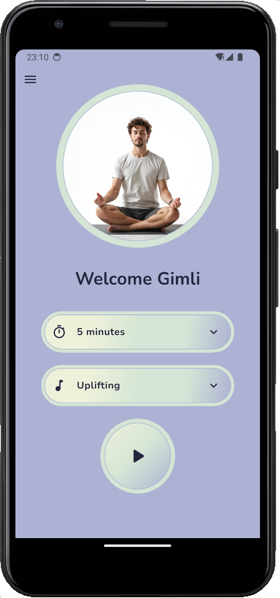
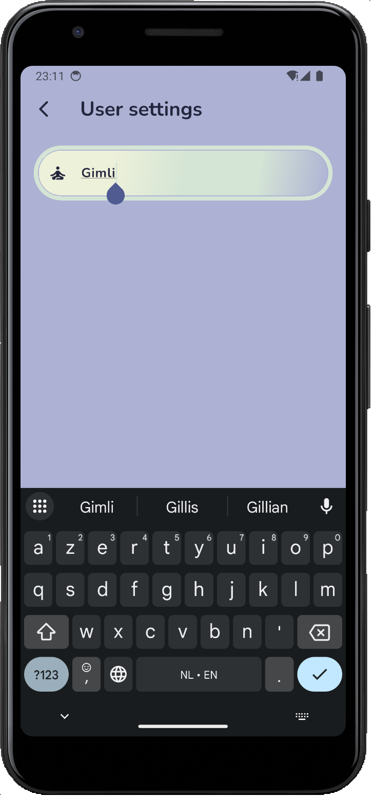

# Meditate App

A simple meditation app built with Flutter, created to experiment with UI design and custom widgets.

## Screens

### Home
Set your meditation duration and background sound, then start a session.

### Session
A countdown timer with audio playback and a vibration notification when the session ends.

### Settings
Customize your display name.

### Pick Avatar
Choose an avatar that suits you.

### Support free apps! 
If you like it, please consider buying me a coffee.

